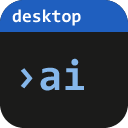

# ai-desktop

[](https://wkdsteve.github.io/wkd/apps/ai-desktop/)

Local agent-framework server (C++17, `cpp-httplib`). Serves as the backend
for a live dashboard (SSE) and as an ask/stream endpoint for editor
integrations (see [`ai.nvim`](../ai.nvim)'s `ai_desktop` provider, there
`lua/ai/providers/ai_desktop.lua`).

*[Deutsche Version](README.de.md)*

## Formerly called loomAI

The program was renamed from loomAI to ai-desktop (the page shows it as "ai", in German as "KI"). What you set up under the
old name keeps working: the variables `LOOMAI_*` (`AI_DESKTOP_*` wins when both are set), the configuration folder
(`%APPDATA%\loomai`, `~/.config/loomai`; it stays in use until a folder `ai-desktop` exists) and the API keys in the
Windows Credential Manager (`loomai/<name>`; read when there is none under `ai-desktop/<name>`, deleted together). The
installer upgrades an installation of loomAI in place and removes its old program file and shortcut. An install made with
`scripts/setup.*` went to `...\loomAI` or `~/.local/share/loomai`; delete that folder and the launcher `loomai` by hand.
The old GitHub address redirects to this repository.

## Get ai-desktop

Releases carry the Windows installer only; Linux and macOS are built from source. CI runs on the
author's self-hosted Windows runner, by choice; pull requests are checked on GitHub-hosted runners
([`pr.yml`](.github/workflows/pr.yml)).

[**Download the latest release**](https://github.com/WKDSteve/ai-desktop/releases/latest)
-- `ai-desktop-setup-<version>-x64.exe`, a Windows installer, no compiler or MSYS2
needed. It installs for the current user (no administrator rights), adds a
Start-menu entry, and can optionally put the `ai-desktop` command on your `PATH`.
Start it from the Start menu or with `ai-desktop`; it serves the dashboard on
`http://127.0.0.1:8080/`. Uninstall via *Settings -> Apps*.

The installer is not code-signed, so Windows SmartScreen may warn ("More info",
then "Run anyway"). Each release also carries a `SHA256SUMS` file (v0.1.0: a
`.sha256` file) to check the download against `Get-FileHash`. Built by
[`.github/workflows/release.yml`](.github/workflows/release.yml) from a pushed
`vX.Y.Z` tag, and verified there by installing, starting and uninstalling it
before it is offered. On Linux/macOS (not built or tested by CI), or to build it
yourself, use the scripts below.

**Or install it with a script** -- for the current user, no administrator
rights, and nothing for SmartScreen to stop: a file the script downloads
carries no "from the internet" mark, so the script checks it against
`SHA256SUMS` instead and runs nothing that does not match (that proves the
file is whole and the release's own, not who made the release). In your own
PowerShell, not elevated:

```powershell
# the newest state of main (the pre-release "latest")
powershell -ExecutionPolicy Bypass -c "irm https://github.com/WKDSteve/ai-desktop/releases/download/latest/install.ps1 | iex"

# a release: the same with the tag in place of latest, e.g. .../releases/download/v0.1.1/install.ps1
```

The script of a release installs exactly that release, the script of `latest`
the rolling build ([`rolling.yml`](.github/workflows/rolling.yml), rebuilt
after every green CI run on `main` and proven by installing, starting,
updating and uninstalling it, for trying what is new). The line above installs
without the "add to PATH" step, so the `ai-desktop` command is not in new
terminals; start ai-desktop from the Start menu (add `/TASKS=desktopicon` to `-InstallArgs` for a shortcut on the desktop as well). For the step, or any other
argument of the script, save the script first and pass the arguments:

```powershell
irm https://github.com/WKDSteve/ai-desktop/releases/download/latest/install.ps1 -OutFile "$env:TEMP\install.ps1"
& "$env:TEMP\install.ps1" -InstallArgs '/TASKS=addtopath'
```

(For a private fork, where anonymous downloads fail: download the script with `gh release download`
and set `GH_TOKEN` to a token that can read the repository; the script then downloads through the API.)

Saved as a file, the script is run as `powershell -ExecutionPolicy Bypass -File
.\install.ps1 -InstallArgs '/TASKS=addtopath'` (one value per `-File` command
line: a list would arrive as one string; in a PowerShell session
`-InstallArgs 'a','b'` is fine). `-File <setup.exe>` installs a setup you
already have; its checksum then comes from `-Sums`, `-Sha256` or a
`SHA256SUMS` beside it. Run the script again to repair or update (stop ai-desktop
first if it is running). The scripts are the ones of appkit's
[release-kit](https://github.com/WKDSteve/appkit/tree/main/release-kit),
stamped for this app and the channel when they are attached. (v0.1.0 predates
them and has no script.)

## Installing from source

The setup scripts do everything below in one go: check the prerequisites,
fetch the two header-only dependencies (pinned versions, SHA-256 verified),
build, install, and smoke-test the installed copy against `GET /health`.

Windows (MSYS2/MinGW-w64; CMake >= 3.20 must be installed already):

```powershell
.\scripts\setup.ps1 -InstallDeps -AddToPath
```

`-InstallDeps` pulls gcc, make and OpenSSL via MSYS2's `pacman`, `-AddToPath`
adds the install directory to your user `PATH`. Further switches: `-Prefix`
(default `%LOCALAPPDATA%\ai-desktop`), `-BuildType`, `-Clean`, `-CheckOnly`,
`-SkipInstall`, `-SkipSmokeTest`, `-Uninstall`. Run
`Get-Help .\scripts\setup.ps1 -Detailed` for details. A g++ on `PATH` without
OpenSSL (WinLibs, Strawberry Perl) does not hide a complete MSYS2 toolchain:
the first one with the OpenSSL files is used.

The same entry points the other desktop apps have, for a terminal on a machine
where no setup may be started (build, install with the launcher on `PATH`;
remove both the copy of the scripts and the one of the setup):

```powershell
.\scripts\build-install.ps1 [-BuildOnly] [-NoPath]
.\scripts\uninstall.ps1
```

Linux/macOS (CMake >= 3.20, a C++17 compiler, curl, OpenSSL dev files):

```bash
scripts/setup.sh
```

Options: `--prefix`, `--bin-dir`, `--build-type`, `--clean`, `--check`,
`--skip-install`, `--skip-smoke-test`, `--uninstall` (see `--help`).

The server serves `./dashboard` relative to its working directory, so the
installed layout is `<prefix>/app` (binary, dashboard, on Windows the runtime
DLLs) plus a launcher -- `<prefix>\ai-desktop.cmd` on Windows, `~/.local/bin/ai-desktop`
elsewhere -- that starts it from the right directory. Start ai-desktop with the
launcher, not with `app/ai-desktop` directly. The scripts never write API keys;
set them in your environment (see "Running").

## Building

Dependencies are header-only and vendored locally into `third_party/` (not
checked into git, see `.gitignore`):

```bash
mkdir -p third_party/nlohmann
curl -sL https://github.com/nlohmann/json/releases/download/v3.11.3/json.hpp \
    -o third_party/nlohmann/json.hpp
curl -sL https://raw.githubusercontent.com/yhirose/cpp-httplib/v0.15.3/httplib.h \
    -o third_party/httplib.h
```

The ModelRouter additionally needs OpenSSL (headers + lib) for the HTTPS
calls to OpenAI/Anthropic/Gemini (`ollama_client` alone wouldn't need it,
but all four backends link into one binary). On MSYS2/mingw64:
`pacman -S mingw-w64-x86_64-openssl` (brings headers plus
`libssl`/`libcrypto`); on Debian/Ubuntu `apt install libssl-dev`.

Then build with CMake:

```bash
cmake -B build -DCMAKE_BUILD_TYPE=Debug
cmake --build build -j4
```

On Windows with MinGW/g++, pass the generator explicitly if CMake doesn't
pick the right one automatically -- and set `OPENSSL_ROOT_DIR` if CMake
doesn't find the MSYS2 OpenSSL on its own (a separately installed CMake
doesn't search the mingw64 tree by default):

```bash
cmake -B build -G "MinGW Makefiles" -DCMAKE_CXX_COMPILER=g++ -DCMAKE_BUILD_TYPE=Debug \
    -DOPENSSL_ROOT_DIR=C:/msys64/mingw64
cmake --build build -j4
```

### Dashboard colours and browser checks

The dashboard follows the system's light or dark mode. Its colours are the palette of ai's icon in
`dashboard/palette.css`, a generated file that is never edited by hand; `dashboard/style.css` only uses its tokens,
and `python tools/check-color-literals.py --root dashboard --tokens dashboard/palette.css` refuses a colour written
anywhere else. `e2e/` checks the page with axe in light and dark against the built binary, in the system's Chrome:

```bash
cd e2e && pnpm install && pnpm test
```

## Running

```bash
./build/ai-desktop      # build/ai-desktop.exe on Windows
```

The server binds `127.0.0.1:8080` (deliberately not `0.0.0.0` -- an editor
companion process shouldn't be accidentally reachable on the LAN).

`/ask`/`/ask/stream` route by model-name prefix to one of four backends
(see "ModelRouter" below) -- with no matching prefix (or no `model` at
all), the request goes to local Ollama:

For the Ollama fallback, a local [Ollama](https://ollama.com) instance
must be running (default: `http://127.0.0.1:11434`). A different host can
be set via `AI_DESKTOP_OLLAMA_HOST` (**not** `OLLAMA_HOST` -- that's already
taken by Ollama itself as the Ollama *server's* own bind address, e.g.
`0.0.0.0:11434`, and thus not a valid client target). Default model via
`AI_DESKTOP_DEFAULT_MODEL`, otherwise `llama3.1:8b-q5_K_M`.

Every Ollama request asks for a context window of 32768 tokens
(`options.num_ctx`). Without one, Ollama uses a default that depends on the
GPU -- 4096 tokens on a 12 GB card -- and a longer prompt does not fail: its
beginning is dropped and the model answers from the rest. Change it with the
setting `ollama_num_ctx` (`PUT /settings`) or `AI_DESKTOP_OLLAMA_NUM_CTX`: a
whole number from 0 to 1048576, `0` sends none (Ollama's own default, or
`OLLAMA_CONTEXT_LENGTH` on the Ollama server, applies). More context costs
VRAM; keep one fixed value, since a request with another one makes Ollama
reload the model.

Each of the three cloud backends needs its own API key as an env var,
otherwise `/ask*` reports a clear configuration error instead of
attempting a request:

| Backend | Model-name prefix | Env var |
|---|---|---|
| OpenAI | `gpt-`, `o1-`, `o3-` | `OPENAI_API_KEY` |
| Anthropic | `claude-` | `ANTHROPIC_API_KEY` |
| Gemini | `gemini-` | `GEMINI_API_KEY` |
| Ollama (local) | anything else / no `model` | -- (see above) |

Each backend's prefix list can be overridden wholesale (comma-separated)
via `AI_DESKTOP_PREFIXES_OPENAI`/`AI_DESKTOP_PREFIXES_CLAUDE`/`AI_DESKTOP_PREFIXES_GEMINI`
-- e.g. `AI_DESKTOP_PREFIXES_OPENAI=gpt-,o1-,o3-,o4-` to pick up a new OpenAI
model family without a rebuild. Read once at startup.

`GET /health` shows which backends are currently configured (presence
check only, never the key value itself).

## HTTP API

| Endpoint | Method | Purpose |
|---|---|---|
| `/events` | GET (SSE) | Dashboard events (agent status, decision points) |
| `/decision` | POST | Human-in-the-loop answer for the dashboard |
| `/health` | GET | Cheap readiness check |
| `/ask` | POST | A single prompt → full answer (non-streaming) |
| `/ask/stream` | POST | Same as `/ask`, but as an SSE token stream |
| `/usage` | GET | Usage log: events, totals, by provider and by model (see "Usage log") |
| `/usage/events` | POST | Records a usage event from another client (ai.nvim) |
| `/settings` | GET/PUT | Settings and the price table `prices` for the usage view |

`/health`:

```json
{
  "status": "ready",
  "model_router_ready": true,
  "backends": { "ollama": true, "openai": true, "anthropic": false, "gemini": false }
}
```

`/ask` -- request:

```json
{ "prompt": "...", "system": "optional", "model": "optional", "timeout_ms": 60000 }
```

`timeout_ms` defaults to 60000 for the three cloud backends and 120000 for
Ollama (a local model can take several seconds just to load on a cold
first request) -- only when the request omits it.

`/ask` -- response (`200`):

```json
{ "text": "...", "provider": "ai_desktop", "stop_reason": "stop", "usage": { "prompt_tokens": 37, "completion_tokens": 3 } }
```

`/ask` -- error (`4xx`/`5xx`):

```json
{ "error": { "message": "ollama: connection refused" } }
```

`/ask/stream` -- SSE, one JSON object per `data:` line, terminated by
`data: [DONE]`. An error mid-stream is sent as a regular SSE event
(`data: {"error":{"message":"..."}}`), not as an aborted connection:

```
data: {"delta": "Hello"}

data: {"delta": ", world"}

data: [DONE]
```

The motivation for this contract (what `ai.nvim` requires from a provider)
lives in `ai.nvim`'s `lua/ai/providers/ai_desktop.lua` (the module doc comment
at the top of the file).

### Usage log

Every `/ask` and `/ask/stream` request leaves one line in `usage.jsonl` in the
configuration folder (the folder of `config.json`, including the loomAI
fallback). **Metadata only**: provider, model, token counts, duration and
outcome -- never the prompt, the system text or the answer. The dashboard's
"Nutzung" section reads it (filtered by provider and time span; while a
provider is chosen, an x in the choice takes it away in one click, as do Delete
and Backspace); `ai.nvim` reports its own requests to the other providers
through `POST /usage/events`. One event:

```json
{ "ts": "2026-10-30T12:34:56Z", "source": "ai-desktop", "provider": "anthropic", "model": "claude-haiku-4-5",
  "stream": false, "ok": true, "error_kind": "backend_error (only when ok is false)",
  "prompt_tokens": 37, "completion_tokens": 3, "duration_ms": 812 }
```

`provider` is the backend the ModelRouter picked (`ollama`, `openai`,
`anthropic`, `gemini`, `openai-compatible`); `error_kind` is `backend_error`,
`invalid_request`, `no_key` or `internal_error`. A streamed request is logged
with zero tokens (the streaming backends report none). The request's `model`
is stored as given, cut to 200 characters; one with a control character is
stored as `(invalid)`. A line of the file that does not parse, or whose fields
have the wrong type, is skipped when reading.

`POST /usage/events` takes an event without `ts` and `source` (the server
stamps the time; `source` defaults to `ai.nvim`, a given string is kept, 32
characters at most). `provider` and `model` are required, the numbers must not
be negative, the body may not exceed 4 KiB, and a body that carries a field
named `prompt`, `text`, `system`, `messages`, `input`, `output`, `content` or
`response` is refused with `400` naming the field -- the log must never hold
conversation text. Answer: `200 {"ok":true}`.

`GET /usage?provider=<id>&since=<ISO>&until=<ISO>&limit=<n>` answers with the
newest matching events (`limit` default 200, at most 2000) and the sums over
*all* matching events; `provider` matches exactly, `since`/`until` are
inclusive on `ts` and must have exactly the stored shape
`YYYY-MM-DDTHH:MM:SSZ` (UTC, whole seconds, no offset -- any other ISO 8601
spelling is refused with `400`, because the comparison is a string
comparison), no filter means everything:

```json
{ "events": [ ... newest first ... ],
  "totals": { "requests": 12, "ok": 11, "failed": 1, "prompt_tokens": 4821, "completion_tokens": 930,
              "cost_usd": 0.0123, "unpriced": 0 },
  "by_provider": { "anthropic": { "requests": 7, "prompt_tokens": 3000, "completion_tokens": 600, "cost_usd": 0.0105, "unpriced": 0 } },
  "by_model": { "claude-haiku-4-5": { ... same shape ... } } }
```

Costs come from the price table `prices` in the settings (USD per million
tokens): `GET /settings` reports it beside `settings`, `PUT /settings
{"prices": {"<model>": {"input_per_mtok": 1.0, "output_per_mtok": 5.0}}}`
overrides or adds a model (`null` for a model drops the override, `null` for
`prices` drops them all). A model is matched exactly first, else by the longest
key that is a prefix of its name; Ollama models cost nothing. Built-in defaults
cover the common OpenAI, Anthropic and Gemini models as priced in 2026-10 --
prices change, so check them against the providers' pages. As soon as one event
in a group has no price, that group's `cost_usd` is `null` and `unpriced`
counts those events: no silent partial sums.

## ModelRouter

`/ask`/`/ask/stream` dispatch by model-name prefix to one of four backend
clients (`src/{ollama,openai,anthropic,gemini}_client.{hpp,cpp}`), see the
table above. Deliberately prefix-based routing instead of an explicit
`provider` field in the request: the HTTP contract stays unchanged (no
adjustment needed in `ai.nvim`'s `ai-desktop.lua`). Every cloud client
defensively handles an error mid-stream (see `model_client.hpp`'s
`error_text`/`recover_error_body`) -- an auth error response from
OpenAI/Anthropic/Gemini sometimes comes back as a raw, non-SSE-shaped JSON
body with no trailing newline instead of an SSE event; verified live
against all three real APIs (including a deliberately invalid test key to
trigger the error path), not just assumed.

The Gemini client additionally recognizes a safety/policy block returned
by Google (`promptFeedback.blockReason` with no `candidates`, a normal
`200` response with no `error` field) and reports it as an error
(`gemini: prompt blocked (SAFETY)` or similar) instead of an empty
success. `model` is also restricted to a safe character set
(`[A-Za-z0-9._-]`) for the Gemini client before it lands in the request
URL -- unlike OpenAI/Anthropic, which send `model` safely inside the JSON
body, Gemini builds the path directly from the model name
(`/v1beta/models/<model>:generateContent`).

## Status / what's missing

- No auth/API key needed for the server itself. `127.0.0.1`-only binding
  alone doesn't stop a web page open in the same browser from firing
  requests at it though, so every request is additionally checked against
  its `Origin` header: a request whose `Origin` names a foreign page is
  rejected with `403` before it reaches any route handler (a browser
  cannot forge or omit that header for a genuinely cross-origin request).
  curl-based clients (`ai.nvim`'s `ai-desktop.lua`, plain `curl`) send no
  `Origin` header at all and are unaffected; the three cloud *backends*
  obviously still need their own keys, see above.
- `ollama_client.cpp` opens a new TCP connection to Ollama per request
  instead of reusing one -- known, deliberately deferred (would need a
  proper pooling design), see the `ai.nvim` handover.
- The model-name-prefix list (`gpt-`/`o1-`/`o3-`/`claude-`/`gemini-`) is
  hardcoded in `main.cpp`'s router, no configuration option for
  custom/future prefixes -- no need for that so far, since all three
  providers prefix their model names stably this way.
